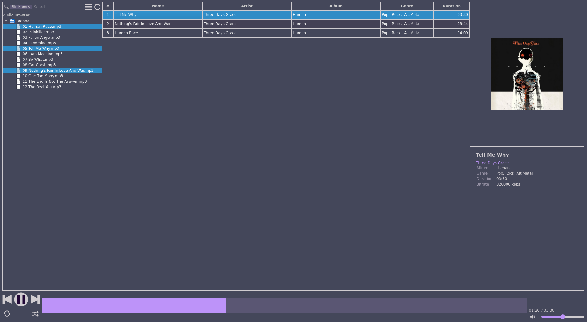

# Wave - listen to your local audio files



## Develop

To build the project install the qt creator from the link below with the versions mentioned. Both are automatically installed from the link above using the [online installer](https://download.qt.io/official_releases/online_installers/)

> Qt creator - 16.0.1
>
> Qt library - 6.5.0 or newer (6.9.0 recommended)

Tested on the reccomended versions only.

> LLVM-MinGW - 17.0.6 (windows)
>
> Clang - 14 (Linux)

## NixOS
1. Clone the repo
```
git clone https://github.com/kokosv/music_player.git
cd music_player
```
2. Enter dev shell for all dependencies
```
nix develop
```
3. Build the project
```
nix build
```
Extras:
- If you want just the dev shell you can do (without cloning the repo)
```
nix develop github:kokosv/music_player

```
## Usage

### Windows

Windows is supported only for the legacy **v1.0** release. Tested on Windows 10 / Build 19045.5854. The .exe can be found in Releases. 

### NixOS

The up-to-date **v2.0** version (this repo's `main` branch) is the one supported on NixOS, built and run through the flake as described in [Build](#build).

To use it outside of this repo, add it as a flake input and pull the package straight from it - no need to clone anything. Use whichever remote you prefer:

**Master (`git.vafla.eu`):**

```nix
{
  inputs = {
    nixpkgs.url = "github:nixos/nixpkgs";
    music-player.url = "git+https://git.vafla.eu/koko/Wave";
  };
```

**Mirror (`github.com`):**

```nix
{
  inputs = {
    nixpkgs.url = "github:nixos/nixpkgs";
    music-player.url = "github:kokosv/Wave";
  };
```

> Note: the flake currently only exposes a package/devShell for `x86_64-linux` (see `flake.nix`), so `packages.${system}.default` only resolves on that system.

## Useful

Documentation for [media managment](https://www.qt.io/product/qt6/qml-book/ch11-multimedia-multimedia)
